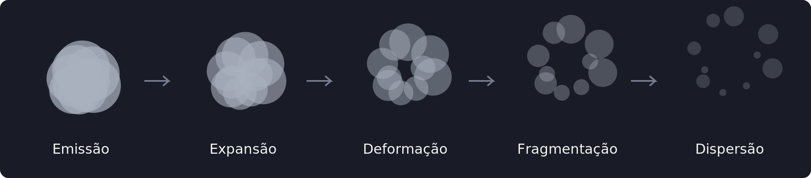
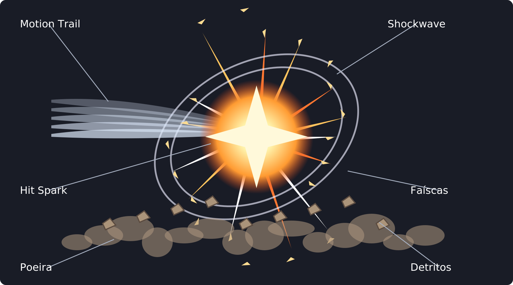

# SŌKON: BLOODLINES — Bíblia de VFX e roadmap do SokonFX

Documento de planejamento de produção. Reúne integralmente o inventário inicial e sua revisão ampliada, preservando as categorias, nomes técnicos, prioridades, exemplos, parâmetros e recursos propostos. Os componentes interativos foram convertidos em checklists, tabelas e descrições Markdown; esta edição inclui novas referências visuais externas por URL e dois diagramas esquemáticos locais. As referências a jogos e ao glossário são mantidas como referências conceituais, sem alegar nova verificação.

> **Nota sobre imagens:** as referências externas foram selecionadas novamente; não são os arquivos exatos exibidos no chat. O download local não foi possível, portanto as imagens externas dependem de conexão e da disponibilidade do servidor. Os dois diagramas PNG estão incluídos localmente. Referências de terceiros são apenas para estudo visual; verificar licenças antes de utilizar em produção.


# PARTE I — Inventário inicial de efeitos

Pensando no **SŌKON: BLOODLINES como um jogo de luta 2D de nível comercial**, a biblioteca de VFX é dividida em efeitos universais, efeitos de combate, efeitos ambientais e efeitos exclusivos dos personagens.

A ideia é que o SokonFX consiga produzir a maior parte desses efeitos proceduralmente, permitindo reaproveitamento e variações de intensidade, cor, direção, duração e dissipação.

**Legenda:** 🔴 Essencial · 🟡 Refinamento · 🔵 Avançado

## 1. Impactos (Hit Sparks)

| Efeito | Nome técnico | Prioridade |
|---|---|---|
| Impacto leve | Light Hit Spark | 🔴 |
| Impacto médio | Medium Hit Spark | 🔴 |
| Impacto pesado | Heavy Hit Spark | 🔴 |
| Impacto crítico | Critical Hit Spark | 🔴 |
| Impacto de contra-ataque | Counter Hit Spark | 🔴 |
| Impacto de projétil | Projectile Hit | 🔴 |
| Impacto de energia | Energy Hit | 🔴 |
| Impacto de agarrão | Throw Impact | 🔴 |
| Choque entre golpes | Clash Spark | 🔴 |
| Ondas de impacto | Shockwave | 🔴 |
| Fragmentos de impacto | Impact Debris | 🟡 |
| Impacto com distorção | Distortion Hit | 🔵 |
| Impacto de finalização | Finisher Impact | 🔵 |

## 2. Fumaça (Smoke)

| Efeito | Nome técnico | Prioridade |
|---|---|---|
| Fumaça de deslocamento | Movement Smoke | 🔴 |
| Fumaça de arrancada | Dash Smoke | 🔴 |
| Fumaça de frenagem | Brake Smoke | 🔴 |
| Fumaça de salto | Jump Smoke | 🔴 |
| Fumaça de super salto | Super Jump Smoke | 🔴 |
| Fumaça de aterrissagem | Landing Smoke | 🔴 |
| Fumaça de queda pesada | Heavy Landing Smoke | 🔴 |
| Fumaça de arrasto | Ground Slide Smoke | 🔴 |
| Fumaça de explosão | Explosion Smoke | 🔴 |
| Fumaça ascendente | Rising Smoke | 🟡 |
| Fumaça residual | Residual Smoke | 🟡 |
| Fumaça de alta velocidade | Speed Smoke | 🟡 |
| Fumaça circular expansiva | Smoke Ring | 🟡 |
| Fumaça de vaporização | Vaporization | 🔵 |

## 3. Terra, poeira e detritos (Dust & Debris)

| Efeito | Nome técnico | Prioridade |
|---|---|---|
| Poeira de passos | Footstep Dust | 🔴 |
| Poeira de dash | Dash Dust | 🔴 |
| Poeira de salto | Jump Dust | 🔴 |
| Poeira de aterrissagem | Landing Dust | 🔴 |
| Poeira de queda violenta | Ground Impact Dust | 🔴 |
| Poeira de deslizamento | Sliding Dust | 🔴 |
| Pequenos fragmentos de terra | Dirt Debris | 🔴 |
| Pedras projetadas | Rock Debris | 🔴 |
| Solo rachando | Ground Crack | 🟡 |
| Solo se despedaçando | Ground Shatter | 🟡 |
| Onda circular de poeira | Dust Ring | 🟡 |
| Terra suspensa por energia | Levitation Debris | 🔵 |
| Cratera de impacto | Impact Crater | 🔵 |

## 4. Rastros de movimento (Motion Trails)

Referências visuais: Punch Trail (rastro curvo branco de soco em anime 2D); Kick Trail (arco crescente do chute); Afterimage (múltiplas silhuetas de movimento); Whip Trail (rastro chicoteado, como Flicker Jab).

**Referências visuais adicionais (não são as imagens exatas do chat):**


[Arcos de movimento e cortes — fonte](https://www.pinterest.com/pin/slash-sprite-sheet-mega-pack--985092118469840641/)

[Punch, dash, afterimage e barrage — galeria de exemplos — fonte](https://particlefx.studio/cartoon-fx)


| Efeito | Nome técnico | Prioridade |
|---|---|---|
| Rastro de soco | Punch Trail | 🔴 |
| Rastro de chute | Kick Trail | 🔴 |
| Rastro de golpe circular | Arc Trail | 🔴 |
| Rastro de uppercut | Rising Trail | 🔴 |
| Rastro de golpe descendente | Descending Trail | 🔴 |
| Rastro de movimento corporal | Body Motion Trail | 🔴 |
| Rastro de velocidade | Speed Trail | 🔴 |
| Imagens residuais do personagem | Afterimage | 🔴 |
| Rastro de golpe chicoteado | Whip Trail | 🟡 |
| Múltiplos punhos | Barrage Trail | 🟡 |
| Distorção do ar pelo golpe | Air Distortion | 🔵 |
| Rastro de ruptura espacial | Spatial Trail | 🔵 |

## 5. Defesa e mecânicas de combate

| Efeito | Nome técnico | Prioridade |
|---|---|---|
| Defesa alta | High Guard Spark | 🔴 |
| Defesa baixa | Low Guard Spark | 🔴 |
| Defesa perfeita | Perfect Guard | 🟡 |
| Quebra de guarda | Guard Break | 🔴 |
| Defesa de projétil | Projectile Guard | 🔴 |
| Cancelamento de projéteis | Projectile Clash | 🔴 |
| Atordoamento | Stun Effect | 🟡 |
| Recuperação aérea | Air Recovery | 🟡 |
| Recuperação no solo | Ground Recovery | 🟡 |
| Armadura de golpe | Super Armor Effect | 🟡 |
| Reversão de golpe | Reversal Effect | 🟡 |
| Escape de agarrão | Throw Tech | 🟡 |

## 6. Energia e Tōkon

| Efeito | Nome técnico | Prioridade |
|---|---|---|
| Aura leve | Light Aura | 🔴 |
| Aura média | Medium Aura | 🔴 |
| Aura intensa | Heavy Aura | 🔴 |
| Concentração de energia | Energy Charge | 🔴 |
| Explosão de energia | Energy Burst | 🔴 |
| Partículas ascendentes | Rising Particles | 🔴 |
| Esfera de energia | Energy Orb | 🔴 |
| Projétil de energia | Energy Projectile | 🔴 |
| Rastro de projétil | Projectile Trail | 🔴 |
| Explosão de projétil | Projectile Explosion | 🔴 |
| Feixe de energia | Energy Beam | 🔴 |
| Onda de energia | Energy Wave | 🔴 |
| Anel de energia | Energy Ring | 🟡 |
| Energia espiralada | Energy Spiral | 🟡 |
| Absorção de energia | Energy Absorption | 🟡 |
| Dissipação de energia | Energy Dissipation | 🔴 |
| Filamentos de energia | Energy Tendrils | 🟡 |
| Vórtice de energia | Energy Vortex | 🔵 |

## 7. Efeitos elementais

Referências visuais: fogo (chamas e explosões); eletricidade (raios e arcos); vento (vórtices e cortes); gelo (cristais e estilhaços); água (respingos); energia sombria (aura roxa e negra).

**Referências visuais adicionais (não são as imagens exatas do chat):**


[Cortes elementais: fogo, raio, gelo, vento e água — fonte](https://booth.pm/ja/items/384853)


[Energia sombria — explosão e dissipação — fonte](https://ducvu.gumroad.com/l/2d-fx-explosion-pack)


| Família | Variações necessárias |
|---|---|
| Fogo | Chamas, labaredas, brasas, explosão, combustão |
| Eletricidade | Raios, arcos elétricos, descargas, faíscas |
| Vento | Rajadas, cortes de ar, tornados, vórtices |
| Gelo | Cristais, congelamento, estilhaços, névoa gelada |
| Água | Ondas, respingos, jatos, gotas |
| Terra | Rochas, fragmentos, rachaduras, erupções |
| Energia sombria | Aura, tentáculos, partículas, névoa |
| Luz | Flashes, raios, partículas luminosas |
| Energia espiritual | Almas, manifestações, silhuetas |
| Sangue | Respingos estilizados, gotas, rastros |

Esses efeitos dependerão das habilidades definitivas dos 16 personagens.

## 8. Explosões

| Efeito | Nome técnico | Prioridade |
|---|---|---|
| Explosão pequena | Small Explosion | 🔴 |
| Explosão média | Medium Explosion | 🔴 |
| Explosão grande | Large Explosion | 🔴 |
| Explosão direcional | Directional Explosion | 🔴 |
| Explosão no chão | Ground Explosion | 🔴 |
| Explosão aérea | Air Explosion | 🔴 |
| Explosão de múltiplos estágios | Multi-stage Explosion | 🟡 |
| Implosão | Implosion | 🟡 |
| Explosão em cadeia | Chain Explosion | 🟡 |
| Explosão cinematográfica | Cinematic Explosion | 🔵 |

## 9. Super e Ultra

| Efeito | Nome técnico | Prioridade |
|---|---|---|
| Flash de ativação | Super Flash | 🔴 |
| Congelamento temporal | Super Freeze | 🔴 |
| Escurecimento do cenário | Background Dim | 🔴 |
| Concentração radial de energia | Radial Charge | 🔴 |
| Linhas de velocidade | Speed Lines | 🔴 |
| Linhas radiais | Radial Lines | 🔴 |
| Quadro de impacto | Impact Frame | 🔴 |
| Silhueta de impacto | Impact Silhouette | 🟡 |
| Inversão de cores | Color Inversion | 🟡 |
| Aberração cromática | Chromatic Aberration | 🟡 |
| Distorção de tela | Screen Distortion | 🟡 |
| Ruptura visual da tela | Screen Shatter | 🔵 |
| Finalização cinematográfica | Cinematic Finish | 🔵 |

## 10. Shinkai

Como o Shinkai representa uma transformação com uma segunda barra de vida independente, ele precisa ter uma identidade visual própria, diferente da simples ativação de um Super.

| Efeito | Nome técnico | Prioridade |
|---|---|---|
| Despertar do Shinkai | Awakening | 🔴 |
| Explosão de transformação | Transformation Burst | 🔴 |
| Aura permanente | Persistent Aura | 🔴 |
| Partículas corporais | Body Particles | 🔴 |
| Pulsação de energia | Energy Pulse | 🔴 |
| Transição de aparência | Transformation Transition | 🔴 |
| Dissipação da transformação | Transformation End | 🔴 |
| Manifestação espiritual | Spiritual Manifestation | 🟡 |
| Alteração de iluminação | Environmental Lighting | 🟡 |
| Distorção gravitacional | Gravity Distortion | 🔵 |

## 11. TAG e Assist

| Efeito | Nome técnico | Prioridade |
|---|---|---|
| Entrada do parceiro | Tag In | 🔴 |
| Saída do personagem | Tag Out | 🔴 |
| Entrada de assistência | Assist Entry | 🔴 |
| Saída de assistência | Assist Exit | 🔴 |
| Rastro de entrada | Tag Trail | 🔴 |
| Flash de troca | Tag Flash | 🟡 |
| Ataque combinado | Dual Attack Effect | 🟡 |
| Super combinado | Dual Super Effect | 🔵 |

## 12. Efeitos ambientais dos cenários

| Efeito | Nome técnico |
|---|---|
| Folhas caindo | Falling Leaves |
| Pétalas ao vento | Flying Petals |
| Poeira atmosférica | Ambient Dust |
| Chuva | Rain |
| Respingos de chuva | Rain Splash |
| Neve | Snow |
| Névoa | Fog |
| Chamas de tochas | Torch Fire |
| Brasas flutuantes | Floating Embers |
| Raios de tempestade | Lightning |
| Ondulação da água | Water Ripple |
| Reflexos luminosos | Light Reflection |
| Raios solares | God Rays |
| Distorção pelo calor | Heat Haze |
| Ondulação de tecidos | Cloth Motion |
| Destruição de objetos | Environmental Destruction |

## 13. Efeitos processados pelo motor do jogo

Estes não precisam necessariamente ser sprites gerados pelo SokonFX.

| Efeito | Nome técnico |
|---|---|
| Tremor de câmera | Camera Shake |
| Congelamento de impacto | Hitstop |
| Câmera lenta | Slow Motion |
| Aproximação de câmera | Dynamic Zoom |
| Deslocamento de câmera | Camera Offset |
| Flash no personagem | Character Flash |
| Flash na tela | Screen Flash |
| Desfoque de movimento | Motion Blur |
| Imagens residuais dinâmicas | Dynamic Afterimage |
| Distorção localizada | Local Distortion |
| Iluminação dinâmica | Dynamic Lighting |
| Brilho de energia | Bloom |
| Separação de canais RGB | RGB Split |
| Vinheta dinâmica | Dynamic Vignette |

## Ordem de desenvolvimento do SokonFX — roadmap inicial

Em vez de desenvolver cada efeito individualmente, criar geradores capazes de produzir famílias inteiras de efeitos.

- [ ] Gerador de fumaça — Em refinamento
- [ ] Gerador de terra e poeira — Próximo
- [ ] Gerador de detritos e fragmentos
- [ ] Gerador de impactos
- [ ] Gerador de rastros de movimento
- [ ] Gerador de ondas de choque
- [ ] Gerador de partículas
- [ ] Gerador de energia e Tōkon
- [ ] Gerador de eletricidade
- [ ] Gerador de fogo
- [ ] Gerador de explosões
- [ ] Gerador de vento e vórtices
- [ ] Gerador de gelo
- [ ] Gerador de líquidos
- [ ] Gerador de auras
- [ ] Gerador de efeitos cinematográficos
- [ ] Compositor de múltiplos efeitos

## Parâmetros universais do SokonFX

Independentemente do gerador, manter uma estrutura comum de controles:

- Intensidade, escala, duração e quantidade de frames.
- Direção, perspectiva, rotação e velocidade.
- Gravidade, vento, turbulência e resistência.
- Pontos de emissão e múltiplos pontos de dissipação.
- Expansão, deformação, fragmentação e dispersão.
- Cor principal, secundária, contorno e luminosidade.
- Curvas de comportamento ao longo da animação.
- Seed procedural para reproduzir resultados.
- Camadas independentes de efeitos.
- Exportação PNG transparente, sequência de frames e spritesheet.

**O mais importante é o compositor de efeitos.** Um impacto pesado, por exemplo, não deveria ser um único efeito, mas uma composição de estrela de impacto, onda de choque, partículas, poeira, detritos e distorção.

Assim, é possível criar centenas de efeitos diferentes utilizando os mesmos geradores, mantendo a identidade visual de anime 2D do SŌKON.

Essa é uma proposta de biblioteca completa para produção, não uma auditoria dos efeitos já implementados no repositório. As prioridades são sugestões de desenvolvimento.

---

# PARTE II — Revisão ampliada e complementos

Revisão da lista anterior considerando as mecânicas do **SŌKON: BLOODLINES**, sua estética de anime dos anos 90, o sistema TAG, Tōkon, Shinkai, Supers, Ultras, cenários e cinematics.

Referências conceituais mencionadas na revisão: jogos de luta como *Guilty Gear* e o *Fighting Game Glossary*. A lista anterior cobria bem os efeitos principais, mas faltavam muitos efeitos intermediários que dão fluidez, peso e legibilidade ao combate. Principalmente os efeitos de deslocamento de ar, lançamento, preparação de golpes, teletransporte, deformação e dissipação.

## 1. Efeitos que faltaram na lista anterior

### Deslocamento de ar (Air Effects)

Referências visuais: pressão de ar (corte branco de vento em anime 2D), anel de ar (onda circular branca transparente), espiral de vento (vórtice branco).

**Referências visuais adicionais (não são as imagens exatas do chat):**


[Onda circular — expansão e dissipação — fonte](https://sinbadstudios.itch.io/20-2d-hand-drawn-explosions-with-fire-smoke-water-lava-and-pixel-art-effects-for)


[Vórtices e anéis de pressão — fonte](https://layerlab.io/products/cartoon-casual-vfx-pack)


- Air Pressure — pressão de ar provocada pelo golpe.
- Air Displacement — deslocamento de ar pelo personagem.
- Air Ring — anel de ar.
- Air Burst — explosão de ar.
- Air Slash — corte de ar.
- Air Compression — compressão de ar.
- Air Wake — turbulência deixada pelo deslocamento.
- Air Spiral — espiral de vento.
- Sonic Boom — ruptura de velocidade.
- Vacuum — efeito de sucção.

### Preparação de golpes (Anticipation Effects)

Referências visuais: concentração no punho (energia luminosa na mão), convergência (linhas e partículas convergindo para o centro), brilho de preparação (faísca em cruz).

**Referências visuais adicionais (não são as imagens exatas do chat):**


[Brilhos, convergência e carga — exemplos variados — fonte](https://layerlab.io/products/cartoon-casual-vfx-pack)

[Animação de carregamento e convergência — fonte](https://particlefx.studio/effects/charge-up)


- Charge Glint — brilho antes do golpe.
- Energy Gathering — convergência de partículas.
- Fist Charge — energia concentrada no punho.
- Foot Charge — energia concentrada no pé.
- Weapon Charge — preparação de armas.
- Ground Pressure — pressão sobre o solo antes do ataque.
- Energy Condensation — condensação de energia.
- Pre-Impact Flash — flash anterior ao impacto.
- Charging Pulse — pulsação durante carregamento.
- Anticipation Lines — linhas de preparação.

### Reações ao dano (Damage Reaction Effects)

| Efeito | Aplicação |
|---|---|
| Launch Effect | Lançamento do adversário pelo 2H |
| Sweep Effect | Derrubada pelo 2M |
| Knockback Trail | Rastro do personagem arremessado |
| Spin Trail | Personagem girando após receber golpe |
| Corkscrew Trail | Rotação corporal em parafuso |
| Ground Bounce | Quique contra o chão |
| Wall Bounce | Ricochete contra a parede |
| Wall Splat | Colisão contra a parede |
| Ground Slam | Arremesso violento contra o chão |
| Body Drag | Corpo sendo arrastado |
| Tumble Trail | Rastro durante rolamento |
| Crumple Effect | Personagem desabando após impacto |
| OTG Impact | Golpe contra adversário caído |
| Air Knockdown | Derrubada aérea |
| Damage Residue | Partículas residuais do dano |

Os efeitos de quique, parede e OTG só serão necessários caso essas interações façam parte do motor.

### Movimentação avançada

- Backdash Effect — deslocamento para trás.
- Air Dash Effect — dash aéreo, caso implementado.
- Direction Change — mudança brusca de direção.
- Pivot Dust — poeira ao girar o corpo.
- Running Trail — rastro de corrida.
- Sudden Stop — parada brusca.
- Wall Jump — impulso contra parede, caso implementado.
- Fast Fall — queda acelerada.
- Aerial Brake — frenagem aérea.
- Foot Skid — arrasto dos pés.
- Evasion Trail — rastro de esquiva.
- Ground Roll — rolamento no chão.

### Teletransporte e desaparecimento

Referências visuais: Vanish (linhas verticais de desaparecimento, como teletransporte de Dragon Ball), fragmentação (desintegração em partículas luminosas), ruptura espacial (portal roxo).

**Referências visuais adicionais (não são as imagens exatas do chat):**


[Portais e colunas de energia — fonte](https://www.freelancer.com/contest/design-shot-sprite-animations-and-some-icons-for-space-shooter-game-369363)

[Vanish de anime — animação de referência — fonte](https://particlefx.studio/effects/anime-teleport-vanish)


Especialmente importantes para personagens como Yín-lù.

- Vanish Effect — desaparecimento instantâneo.
- Reappearance Effect — reaparecimento.
- Teleport In — entrada por teletransporte.
- Teleport Out — saída por teletransporte.
- Vertical Speed Lines — linhas verticais.
- Spatial Rift — ruptura espacial.
- Portal Opening — abertura de portal.
- Portal Closing — fechamento de portal.
- Pixel-free Disintegration — desintegração orgânica.
- Materialization — materialização.
- Residual Silhouette — silhueta residual.
- Spatial Compression — compressão espacial.

### Cortes e armas (Slash Effects)

Referências visuais: Crescent Slash (corte em crescente), Cross Slash (cortes cruzados em X), Multi Slash (múltiplos cortes rápidos).

**Referências visuais adicionais (não são as imagens exatas do chat):**


[Cortes curvos, diagonais e em X — fonte](https://booth.pm/ja/items/384853)

[Cortes múltiplos e clash — galeria — fonte](https://particlefx.studio/cartoon-fx)


Importantes principalmente para Renji e Mizuki, dependendo dos seus golpes.

- Horizontal Slash.
- Vertical Slash.
- Diagonal Slash.
- Crescent Slash.
- Cross Slash.
- Circular Slash.
- Multiple Slash.
- Thrust Effect.
- Delayed Slash.
- Weapon Glint.
- Metal Sparks.
- Weapon Clash.
- Cutting Shockwave.
- Slash Dissipation.

### Partículas independentes

A lista anterior tratava partículas como complemento, mas elas precisam de um gerador próprio.

| Efeito | Comportamento |
|---|---|
| Spark Particles | Faíscas rápidas |
| Floating Particles | Flutuação |
| Falling Particles | Queda por gravidade |
| Orbiting Particles | Órbita |
| Gathering Particles | Convergência |
| Scattering Particles | Dispersão |
| Bouncing Particles | Colisão e quique |
| Stretch Particles | Alongamento pela velocidade |
| Burning Particles | Combustão |
| Glowing Particles | Emissão luminosa |
| Fragmenting Particles | Divisão em partículas menores |
| Particle Trails | Rastros individuais |
| Turbulent Particles | Movimento irregular |
| Spiral Particles | Movimento espiralado |

### Dissipação e encerramento de efeitos

Essa família merece atenção especial pelo que estamos desenvolvendo no SokonFX com a fumaça.

**Diagrama de comportamento:**




```text
Emissão → Expansão → Deformação → Fragmentação → Dispersão
```

Comportamento esquemático de dissipação orgânica, não apenas redução de opacidade. A massa inicial se expande, deforma, sobe e se divide em elementos menores e mais dispersos até desaparecer.

- Organic Dissipation — dissipação orgânica.
- Edge Erosion — erosão das bordas.
- Fragment Dissipation — fragmentação progressiva.
- Vapor Dissipation — vaporização.
- Wind Dispersion — dispersão pelo vento.
- Energy Collapse — colapso energético.
- Inward Dissipation — dissipação para o centro.
- Outward Dissipation — dissipação para fora.
- Burning Dissolve — dissolução por combustão.
- Residual Trails — rastros residuais.
- Ash Dissipation — transformação em cinzas.
- Multi-point Dissipation — múltiplos pontos de dissipação.

Esses comportamentos devem ser compartilhados entre os geradores, não desenvolvidos novamente para cada efeito.

### Deformações e distorções

| Efeito | Aplicação |
|---|---|
| Radial Distortion | Explosões |
| Directional Distortion | Golpes e deslocamentos |
| Ripple Distortion | Ondas de impacto |
| Heat Distortion | Fogo e energia |
| Shockwave Refraction | Ondas de pressão |
| Spatial Warp | Teletransporte |
| Stretch | Alongamento |
| Squash | Compressão |
| Smear | Deformação de movimento |
| Twist | Torção |
| Turbulence | Deformação irregular |
| Displacement | Deslocamento de textura |

### Outros materiais e substâncias

Referências visuais: vidro estilizado despedaçado; gás tóxico verde; líquidos como tinta preta estilizada.

**Referências visuais adicionais (não são as imagens exatas do chat):**


[Gás tóxico — sequência de animação — fonte](https://www.aetherforgeai.com/en/aether-gallery)


[Tinta — formas e respingos — fonte](https://www.behance.net/gallery/91706709/2D-FX-compilation/modules/530124115)

[Quebra e estilhaços — Guard Break Shatter na galeria — fonte](https://particlefx.studio/cartoon-fx)


| Família | Variações |
|---|---|
| Vidro | Rachaduras, quebra, estilhaços |
| Metal | Faíscas, fragmentos, limalhas |
| Madeira | Lascas, quebra, fragmentação |
| Concreto | Pedras, rachaduras, destruição |
| Areia | Rajadas, redemoinhos, dispersão |
| Lama | Respingos, fragmentos úmidos |
| Cinzas | Queda, dispersão, combustão |
| Veneno | Gás, gotas, bolhas |
| Ácido | Respingos, corrosão, vapores |
| Vapor | Condensação, expansão |
| Tinta | Respingos, manchas, pinceladas |
| Plasma | Filamentos, descargas, esferas |
| Energia orgânica | Tentáculos, veias, pulsação |

### Efeitos de contato com superfícies (Decals)

- Marcas de impacto.
- Marcas de queimadura.
- Marcas de arrasto.
- Pegadas.
- Rachaduras persistentes.
- Manchas de líquidos.
- Marcas de cortes.
- Sombras de partículas.
- Marcas de explosão.
- Áreas congeladas.
- Ondulações em superfícies líquidas.

O mesmo golpe deveria produzir resíduos diferentes dependendo do material do chão do cenário.

## 2. Efeitos que faltaram fora do combate

### HUD e interface

Considerando inclusive nosso HUD com vida recuperável, cinco segmentos de TAG/Assist, barras de Super e Shinkai:

| Categoria | Efeitos |
|---|---|
| Vida | Dano, recuperação, vida crítica, esgotamento |
| Super | Preenchimento, segmento completo, consumo, barra máxima |
| TAG | Cooldown, disponibilidade, ativação, bloqueio |
| Assist | Disponível, utilizado, recuperação |
| Shinkai | Despertar, segunda barra, pulsação, esgotamento |
| Combo | Incremento, multiplicador, combo finalizado |
| Cronômetro | Contagem regressiva, tempo crítico |
| Round | Round Start, Fight, KO, Double KO, Time Over |
| Vitória | Perfect, Winner, Victory Transition |
| Seleção | Cursor, confirmação, entrada dos personagens |
| Identidade P1 | Dragão azul, partículas, transições |
| Identidade P2 | Tigre vermelho, partículas, transições |
| Menus | Transições, brilho, seleção, carregamento |

### Cinematics e STAMPS

- Impact Frame branco.
- Impact Frame preto.
- Impact Frame monocromático.
- Impact Frame colorido.
- Transição entre gameplay e STAMP.
- Linhas de concentração.
- Linhas de velocidade em perspectiva.
- Pinceladas de transição.
- Halftone cinematográfico.
- Silhuetas contrastadas.
- Animação de onomatopeias.
- Parallax de ilustração.
- Revelação de personagem.
- Máscaras de transição.
- Letterbox animado.
- Flash de memória.
- Transições de mangá.
- Quebra de enquadramento.
- Efeitos de vinhetas.
- Transição para Ultra.
- Retorno da cinematic ao gameplay.

## 3. Geradores definitivos do SokonFX

Depois da revisão, reorganizar o desenvolvimento em **40 famílias de geradores e ferramentas**, em vez de tentar criar centenas de efeitos manualmente.

### Fase 1 — Fundação física (0/8)

- [ ] Fumaça — Em refinamento
- [ ] Poeira — Próximo
- [ ] Terra e areia
- [ ] Detritos e fragmentos
- [ ] Partículas
- [ ] Faíscas
- [ ] Deslocamento de ar
- [ ] Ondas de choque

### Fase 2 — Combate universal (0/8)

- [ ] Hit Sparks
- [ ] Guard Sparks
- [ ] Motion Trails
- [ ] Slash Effects
- [ ] Speed Lines
- [ ] Explosões
- [ ] Decals e marcas de superfície
- [ ] Brilhos e flashes

### Fase 3 — Energia e poderes (0/13)

- [ ] Auras
- [ ] Energia e Tōkon
- [ ] Projéteis
- [ ] Feixes de energia
- [ ] Eletricidade
- [ ] Fogo
- [ ] Gelo
- [ ] Água e líquidos
- [ ] Vento e vórtices
- [ ] Energia sombria
- [ ] Energia espiritual
- [ ] Gases e vapores
- [ ] Teletransporte e portais

### Fase 4 — Comportamentos e processamento (0/7)

- [ ] Afterimages
- [ ] Deformações
- [ ] Distorções
- [ ] Dissipação
- [ ] Máscaras e dissolução
- [ ] Iluminação e glow
- [ ] Sombras de efeitos

### Fase 5 — Finalização (0/4)

- [ ] Efeitos de HUD
- [ ] Efeitos cinematográficos
- [ ] Transições
- [ ] Compositor multicamadas

**Total do roadmap: 0/40 marcados no checklist inicial.** As marcações não representam auditoria ou confirmação do estado real do código.

## 4. Recursos que o editor também precisa ter

Não são efeitos propriamente ditos, mas são indispensáveis para produzir efeitos profissionais.

| Recurso | Função |
|---|---|
| Timeline | Controlar os efeitos quadro a quadro |
| Keyframes | Animar qualquer parâmetro |
| Curve Editor | Controlar aceleração e comportamento |
| Node Editor | Conectar diferentes comportamentos |
| Shape Editor | Desenhar formas personalizadas |
| Path Editor | Definir trajetórias |
| Emitter Editor | Configurar pontos de emissão |
| Force Fields | Aplicar vento, gravidade, atração e repulsão |
| Collision System | Colisão com chão e superfícies |
| Dissipation Editor | Controlar pontos e formas de dissipação |
| Layer System | Compor efeitos independentes |
| Blend Modes | Normal, Additive, Multiply, Screen etc. |
| Cel Shading | Manter a estética de anime 2D |
| Outline Control | Controlar contornos |
| Color Ramp | Alterar cores ao longo da vida do efeito |
| Texture Import | Utilizar texturas e sprites personalizados |
| Preset Library | Salvar efeitos reutilizáveis |
| Seed Control | Reproduzir resultados procedurais |
| Onion Skin | Visualizar quadros anteriores e posteriores |
| Seamless Loop | Produzir animações contínuas |
| Sprite Attachment | Vincular efeitos a partes do personagem |
| Anchor Points | Definir pontos de origem |
| Gameplay Preview | Testar efeitos sobre personagens e cenários |
| Quality Preview | Verificar definição e transparência |
| Batch Export | Exportar várias variações simultaneamente |
| Sprite Sheet Export | Exportar folhas de sprites |
| Metadata Export | Exportar duração, origem, escala e frames |

## 5. Como todos esses efeitos devem funcionar juntos

Por exemplo, um golpe pesado do Kōga não deveria ser um efeito único.

### Composição de um soco pesado do Kōga

Esquema conceitual da composição de camadas: um núcleo de impacto branco e amarelo, cercado por raios laranja, duas ondas de choque elípticas, rastros brancos direcionais de aproximação, faíscas radiadas, poeira junto ao chão e detritos projetados.




```text
              Motion Trail               Shockwave
                    \                      /
                     \      Hit Spark     /
                      ───►     ✦     ◄───
                             Faíscas
                                |
                  Poeira ───── chão ───── Detritos
```

| Etapa | Composição |
|---|---|
| 1. Preparação | Concentração de energia e pressão de ar |
| 2. Movimento | Motion trail, smear e deslocamento de ar |
| 3. Contato | Hit spark, flash e partículas |
| 4. Propagação | Shockwave, distorção e detritos |
| 5. Reação | Hitstop, camera shake e knockback |
| 6. Encerramento | Dissipação, fragmentação e resíduos |

## 6. Ordem de prioridade geral

| Categoria | Prioridade | Descrição |
|---|---:|---|
| Fundação física | 5/5 | Fumaça, poeira, terra, partículas e ar |
| Combate universal | 5/5 | Impactos, defesa, rastros e ondas de choque |
| Energia e poderes | 5/5 | Tōkon, Shinkai, Supers e Ultras |
| Composição | 5/5 | Combinação e sincronização de efeitos |
| Elementais | 4/5 | Fogo, eletricidade, gelo, água e outros |
| Processamento visual | 4/5 | Distorção, iluminação e deformação |
| Cinematics | 4/5 | STAMP, transições e finalizações |
| HUD e interface | 4/5 | Feedback visual das mecânicas |
| Ambientais | 3/5 | Atmosfera e vida dos cenários |
| Destruição | 2/5 | Objetos e superfícies destrutíveis |

---

## Conclusão e princípios artísticos

**O SokonFX não deveria ser apenas um gerador de sprites de efeitos.** Ele deveria se tornar uma ferramenta especializada em produção, simulação e composição de VFX de jogos de luta 2D.

Precisamos manter como princípio artístico:

- Estética de anime desenhado à mão.
- Cel shading.
- Formas orgânicas.
- Silhuetas bem definidas.
- Dissipação natural.
- Movimento convincente.
- Ausência de aparência 3D.
- Ausência de pixelização indesejada.
- Legibilidade durante o combate.
- Identidade visual consistente.

Com essas 40 famílias, teremos uma estrutura muito mais completa para produzir os efeitos universais e exclusivos dos 16 personagens, além de Takatoshi.

Esta revisão é um planejamento de produção, não uma auditoria do código atual do repositório. As mecânicas adicionais citadas são possibilidades, não alterações nas regras já estabelecidas do SŌKON.
